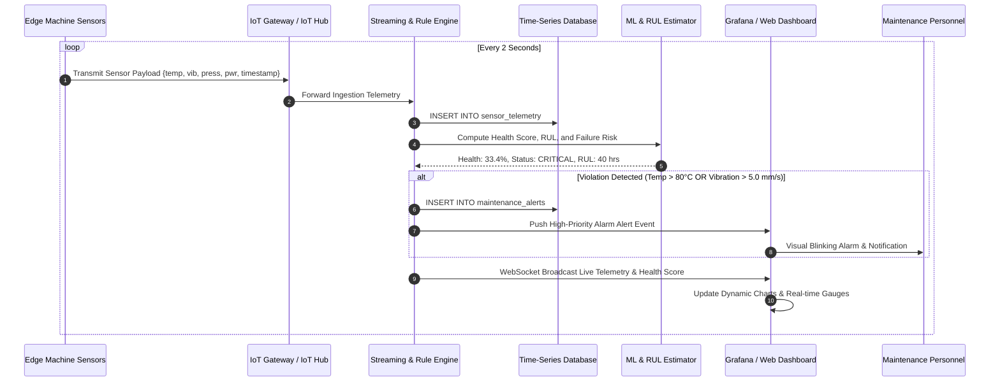

# System Architecture & IoT Data Pipeline Documentation
**Project:** Industrial Equipment Health Monitoring System  
**Course Assignment:** Assignment #23 - Predictive Maintenance Analytics  
**Application Domain:** Smart Manufacturing  
**Authors:** Rakshith C & Deelip  

---

## 1. Solution Architecture Diagram

```mermaid
flowchart TD
    subgraph Industrial_Floor ["Industrial Manufacturing Facility (Edge Layer)"]
        M1["CNC Milling Center<br/>(CNC-M01)"]
        M2["Gas Turbine Gen-2<br/>(TURBINE-02)"]
        M3["Hydraulic Pump<br/>(PUMP-A103)"]
        M4["Centrifugal Compressor<br/>(COMPRESSOR-04)"]
        Sensors["Multi-Sensor Array:<br/>- Temperature (°C)<br/>- Vibration (mm/s)<br/>- Pressure (bar)<br/>- Power (kW)"]
        M1 & M2 & M3 & M4 --> Sensors
    end

    subgraph Cloud_Ingestion ["Cloud Ingestion & Processing Layer (VM / Cloud IoT Hub)"]
        IoTCore["Cloud IoT Hub / AWS IoT Core Broker<br/>(MQTT / WebSockets / HTTPS)"]
        AppServer["Cloud Virtual Machine (AWS EC2 / Azure VM / GCE)<br/>- FastAPI Telemetry Broker<br/>- IoT Streaming Engine<br/>- Rule Evaluation Engine"]
        AnalyticsEngine["Predictive Maintenance Analytics Engine<br/>- Health Score (0-100%)<br/>- RUL Estimator<br/>- Anomaly Detector (ISO 10816)"]
        
        Sensors -->|Telemetry Stream (JSON / MQTT)| IoTCore
        IoTCore --> AppServer
        AppServer <--> AnalyticsEngine
    end

    subgraph Storage_Layer ["Database & Time-Series Storage Layer"]
        TSDB[("Time-Series Storage Engine<br/>(InfluxDB / SQLite TS-Optimized)<br/>- Indexed (machine_id, timestamp)<br/>- Rollups & Downsampling")]
        AlertDB[("Maintenance Alert & Incident Store<br/>- Active / Acknowledged / Resolved")]
        AppServer -->|Persist Readings| TSDB
        AnalyticsEngine -->|Persist Triggered Violations| AlertDB
    end

    subgraph Presentation_Layer ["Visualization & Alert Notification Layer"]
        WebDash["Grafana / SCADA Real-Time Dashboard<br/>- Dual-Axis Telemetry Charts<br/>- Live Health Score Dial<br/>- Failure Prediction Indicators"]
        AlertsPanel["Maintenance Notification Center<br/>- Rule 1: Temp > 80°C<br/>- Rule 2: Vibration > 5.0 mm/s"]
        ReportGen["Automated Daily Equipment Health<br/>& Shift Analytics PDF/HTML Reports"]
        
        AppServer <-->|Real-Time WebSockets| WebDash
        AlertDB --> AlertsPanel
        TSDB & AlertDB --> ReportGen
    end

    classDef edge fill:#1e293b,stroke:#38bdf8,stroke-width:2px,color:#f8fafc;
    classDef cloud fill:#0f172a,stroke:#3b82f6,stroke-width:2px,color:#f8fafc;
    classDef storage fill:#134e4a,stroke:#14b8a6,stroke-width:2px,color:#f8fafc;
    classDef ui fill:#312e81,stroke:#818cf8,stroke-width:2px,color:#f8fafc;

    class M1,M2,M3,M4,Sensors edge;
    class IoTCore,AppServer,AnalyticsEngine cloud;
    class TSDB,AlertDB storage;
    class WebDash,AlertsPanel,ReportGen ui;
```

---

## 2. IoT Data Pipeline Diagram



---

## 3. Database Schema & Data Models

### Time-Series Sensor Telemetry Table (`sensor_telemetry`)
| Column | Type | Index | Description |
|---|---|---|---|
| `id` | INTEGER | PRIMARY KEY | Unique telemetry sequence identifier |
| `machine_id` | TEXT | INDEX | Identifier for the equipment (e.g., CNC-M01) |
| `timestamp` | TEXT | INDEX | ISO-8601 UTC timestamp of sensor recording |
| `temperature` | REAL | - | Equipment thermal sensor reading (°C) |
| `vibration` | REAL | - | Mechanical vibration velocity (mm/s) |
| `pressure` | REAL | - | Hydraulic/pneumatic line pressure (bar) |
| `power` | REAL | - | Electrical power draw (kW) |
| `status` | TEXT | - | Operational state (`NORMAL`, `WARNING`, `CRITICAL`) |

### Maintenance Alerts Log Table (`maintenance_alerts`)
| Column | Type | Description |
|---|---|---|
| `id` | INTEGER | Primary Key |
| `machine_id` | TEXT | Machine triggering the event |
| `timestamp` | TEXT | Trigger timestamp |
| `severity` | TEXT | `WARNING` or `CRITICAL` |
| `rule_triggered`| TEXT | e.g., `RULE-01: HIGH_TEMPERATURE`, `RULE-02: EXCESSIVE_VIBRATION` |
| `metric_name` | TEXT | `temperature` or `vibration` |
| `metric_value` | REAL | Recorded breaching value |
| `threshold_value`| REAL | Benchmark threshold (80.0°C or 5.0 mm/s) |
| `message` | TEXT | Detailed engineering alarm message |
| `status` | TEXT | `ACTIVE`, `ACKNOWLEDGED`, `RESOLVED` |

---

## 4. Cloud Deployment Strategy

1. **Virtual Machine (VM):**
   - Cloud Provider: AWS EC2 (`t3.medium` or `t4g.small`), Azure VM (`Standard_B2s`), or Google Compute Engine (`e2-medium`).
   - Operating System: Ubuntu 22.04 LTS Linux.
   - Web Server: Uvicorn ASGI behind Nginx reverse proxy with HTTPS/SSL.
2. **IoT Ingestion:**
   - Simulated edge telemetry streaming via MQTT / WebSocket or AWS IoT Core / Azure IoT Hub telemetry endpoints.
3. **Time-Series DB:**
   - InfluxDB Cloud / InfluxDB Open Source or optimized indexed time-series SQLite/DuckDB engine.
4. **Dashboards & Visualization:**
   - Embedded Grafana-styled real-time SCADA Web UI + Grafana dashboard provisioning JSON.
